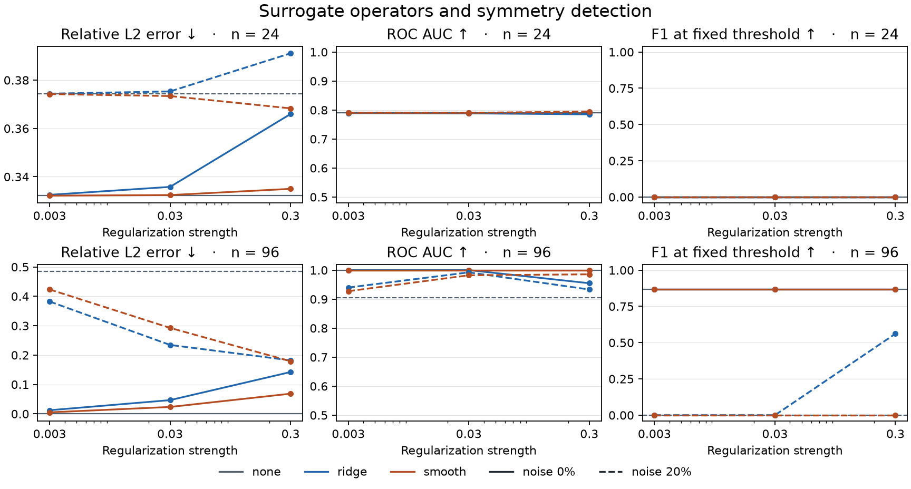

# Пилотный эксперимент

Три диффузионных эталона, 20 случайных выборок, 560 прогонов. Каждый прогон сравнивает 21 кандидатную пару «эталон — преобразование». Набор эталонов расширен после пробного запуска. В задачах с изотропией и сильной анизотропией ROC AUC достигала 1 во всех режимах, поэтому в итоговый протокол добавлен эталон со слабой анизотропией.

Серые горизонтальные линии показывают результаты обучения без регуляризации. Сплошные линии соответствуют чистому обучению, штриховые — шуму в обучающих ответах с масштабом 20% от RMS.

## Что получилось

| Обучающие поля | Шум | Регуляризация | Относительная ошибка L2 ↓ | ROC AUC ↑ | F1 при пороге 0,2 ↑ |
| ---: | ---: | --- | ---: | ---: | ---: |
| 24 | 20% | Без штрафа | 0,374 | 0,790 | 0,000 |
| 24 | 20% | Сглаживание, λ = 0,3 | 0,368 | 0,795 | 0,000 |
| 96 | 0% | Без штрафа | ≈ 0 | 1,000 | 0,867 |
| 96 | 0% | Ridge, λ = 0,3 | 0,142 | 0,955 | 0,867 |
| 96 | 20% | Без штрафа | 0,485 | 0,905 | 0,000 |
| 96 | 20% | Ridge, λ = 0,03 | 0,235 | 0,992 | 0,000 |
| 96 | 20% | Ridge, λ = 0,3 | 0,182 | 0,933 | 0,561 |
| 96 | 20% | Сглаживание, λ = 0,3 | 0,179 | 0,986 | 0,000 |

- На 96 зашумлённых обучающих полях увеличение силы ridge с 0,03 до 0,3 снизило среднюю ошибку прогноза с 0,235 до 0,182. Средняя ROC AUC при этом упала с 0,992 до 0,933, а F1 при пороге 0,2 выросла с 0 до 0,561. Ранжирование кандидатов и решение при фиксированном пороге реагируют на силу штрафа по-разному.
- На 24 полях с шумом сглаживание при λ = 0,3 дало небольшое улучшение относительно базового режима. Средняя парная разность по ошибке прогноза составила −0,0060 с 95%-м бутстрэп-интервалом от −0,0066 до −0,0055. Средняя парная разность ROC AUC составила +0,0048 с интервалом от 0,0010 до 0,0082.
- На 96 чистых полях базовая модель практически точно восстанавливает эталон. Фиксированный порог всё равно классифицирует четыре преобразования со сменой осей в слабоанизотропном эталоне как симметрии. У эталона остатки этих преобразований лежат в диапазоне от 0,093 до 0,100. В этом режиме ROC AUC равна 1, а F1 составляет 0,867. Порог 0,2 используется как фиксированная контрольная точка. Для будущей задачи бинарной классификации следует проверить калибровку порога на отдельном наборе.

Таблица показывает выбранные режимы. [Полная сводка по 28 режимам](pilot/summary.csv) · [Параметры и версии](pilot/metadata.json) · [Методика и ограничения](methodology.md)
